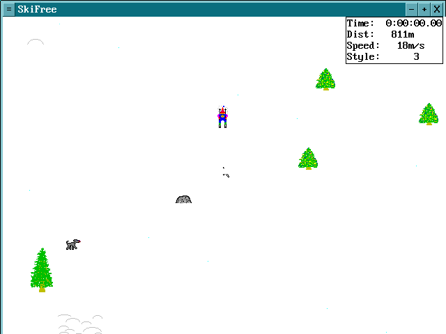
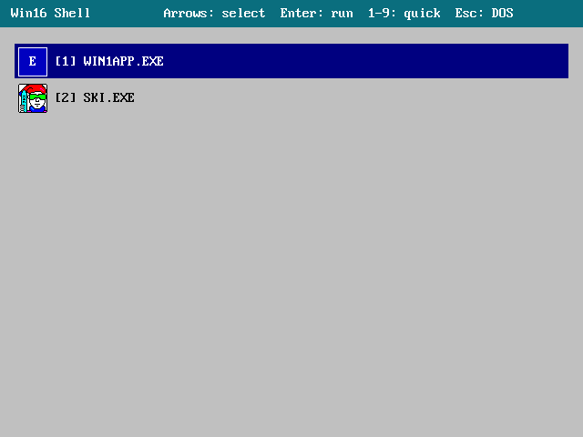
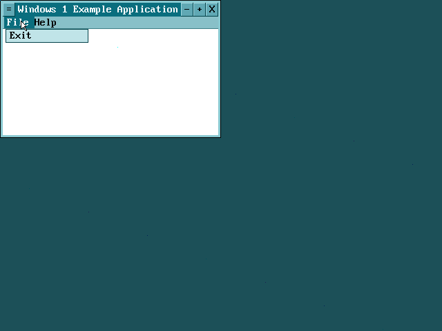

# win16Loader

A minimal Win16 / Windows 3.1 compatible loader for i486, running on top of FreeDOS.

## Goal

The goal of this project is to run original Win16 applications on bare metal (or emulated) i486 hardware without a full Windows installation. The primary target application is **SkiFree** — the classic 1991 skiing game originally written for Windows 3.1, available at https://ski.ihoc.net/

## How it works

The loader boots from a FreeDOS floppy image. It implements:
- NE (New Executable) format parser and loader
- 16-bit protected mode switching via custom GDT/IDT setup
- Minimal Win16 API stubs: `KERNEL.EXE`, `USER.EXE`, `GDI.EXE`
- INT 3F thunk mechanism for DLL calls with proper DS switching
- VESA framebuffer (640×480) with huge-selector GDI rendering
- RT_BITMAP resource loader for 4bpp sprite rendering
- IRQ0 timer, message queue, window manager

## Current state

SkiFree runs (sprites, game loop, status bar). Graphical shell with NE icons, window manager with title bar/close button/system menu/move, proper app exit back to the shell.

The rewritten `KERNEL`/`USER`/`GDI` (directories `kernel/`, `user/`, `gdi/`) plus small system
DLLs (`dlls/`: SHELL, KEYBOARD.DRV, TOOLHELP, DDEML, VER, MMSYSTEM, COMMDLG) run the
**Calmira II** shell (Delphi 1): desktop, taskbar, Start menu, dialogs (`make run-calmira`;
unpack [cal3101p.zip](http://gaby.de/ftp/pub/win3x/cal3101p.zip) into `../win31_apps/cal3101p` first).
Every feature has a test app in `example_apps/` (`python3 tools/run_examples.py`).

## Screenshots

| SkiFree (original Win16 binary) | Graphical shell with NE icons |
|---|---|
|  |  |

| Example Win16 app (menu bar, title bar buttons) |
|---|
|  |

## Build

### Tool versions used

| Tool | Version |
|------|---------|
| Open Watcom C/C++ (wcc, wlink) | 2.0 beta (Nov 3 2025) |
| NASM | 3.01 |
| GNU Make | 4.4.1 |
| QEMU | 11.0.0 |
| Bochs | 3.0 |

Open Watcom is installed at `/opt/watcom`. The Makefile sets the required environment variables (`WATCOM`, `INCLUDE`, `PATH`) automatically.

### Build steps

```bash
make
make run-qemu   # run under QEMU, serial output to stdout
make run        # run under Bochs with GUI debugger
```

## Project structure

Current code lives in the repository root. Historical step-by-step snapshots are in `steps/`:

| Directory | Description |
|-----------|-------------|
| `steps/STEP1` | FreeDOS environment + Hello World COM |
| `steps/STEP2` | Protected mode switcher |
| `steps/STEP3` | Minimal single-segment NE loader |
| `steps/STEP4` | Multi-segment NE loader |
| `steps/STEP5` | Import table + minimal KERNEL.EXE |
| `steps/STEP7` | INT 3F DLL thunk mechanism |
| `steps/STEP8` | USER.EXE: window class, message queue |
| `steps/STEP9` | GDI.EXE: VESA framebuffer + TextOut |
| `steps/STEP10` | Full-screen TextOut via huge selectors |
| `steps/STEP11` | Real Win16 ordinal numbers |
| `steps/STEP12` | GlobalAlloc, InitTask, game loop active |
| `steps/STEP13` | RT_BITMAP loader, sprite rendering |
| `steps/STEP14` | patch_gdt in C (pm_helpers.c) |
| `steps/STEP15` | Wsprintf fix, VERTRES=640, NPC analysis |
| `steps/STEP16`..`STEP20` | Keyboard/mouse, GDI blits, NE resource loader, example app, shell + WM |
| `SKIFREE` | SKI.EXE binary + NE format analysis scripts |

## License

win16Loader is free software; you can redistribute it and/or modify it under the terms of
the **GNU Lesser General Public License, version 2.1 or (at your option) any later version**,
the same license as Wine. See [`LICENSE`](LICENSE).

## Third-party components and credits

| Component | Where | License | Notes |
|-----------|-------|---------|-------|
| Wine bitmap fonts (`sserife`, `vgasys`, `vgafix`, `coure`, `smalle` `.fon`) | `fonts/` | LGPL-2.1+ | Unmodified from Wine 11.20; source and download info in [`fonts/README.md`](fonts/README.md) |
| Wine `.spec` files (`dlls/*16/*.spec`) | read at build/analysis time from `../wine` (not in the repo) | LGPL-2.1+ | `tools/imports.py`, `gen_lnk.py`, `check_args.py`, `gen_apidb.py` take Win16 ordinals, names and argument sizes from them |
| Wine behaviour references | comments in the sources | LGPL-2.1+ | No Wine code is copied; some semantics were matched against Wine (NE export prolog patching `NE_FixupSegmentPrologs`, 3.1 registry, `WM_SIZE` on first `ShowWindow`, owner-draw menu sizes, dialog placement) |
| Win1App example | `win16_example_app/` | Unlicense (public domain) | by Transmission Zero, <https://github.com/TransmissionZero/Windows-1-Example-Application>; local changes in [`win16_example_app/UPSTREAM.md`](win16_example_app/UPSTREAM.md) |
| FreeDOS floppy | `FD14-FloppyEdition/` (not in the repo) | GPL and others | download from <https://www.freedos.org> |
| SkiFree | not in the repo (`SKIFREE/SKI.EXE`) | freeware | test application, <https://ski.ihoc.net/> |
| Calmira II D 3.101.d (German, VVS Berlin) | not in the repo (`../win31_apps/cal3101p`, sources `../win31_apps/calsrc`) | GPL-2.0-or-later | test application; binary <http://gaby.de/ftp/pub/win3x/cal3101p.zip>, sources [cal3101q.zip (Wayback)](http://web.archive.org/web/20101101214316/http://www.vv-soft.de/calmira/cal3101q.zip); project site <http://www.calmira.de/downloads/>, newer 3.3 sources mirrored at <https://github.com/RauliL/calmira> |

Wine: <https://www.winehq.org>, sources <https://gitlab.winehq.org/wine/wine>.
