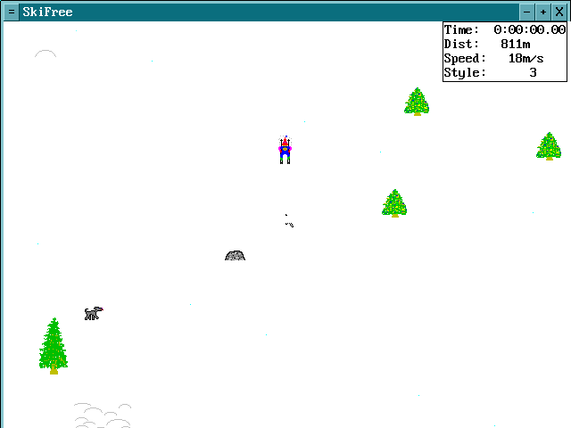
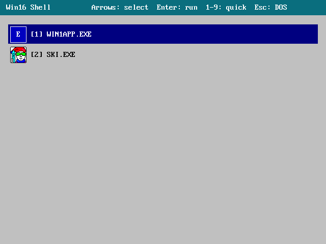
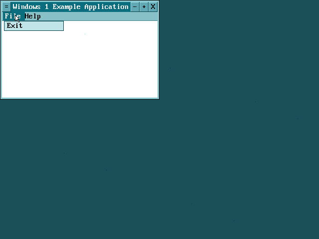

# win16Loader

A minimal Win16 / Windows 3.1 compatible loader for i486, running on top of FreeDOS.

## Goal

The goal of this project is to run original Win16 applications on bare metal (or emulated) i486 hardware without a full Windows installation. The primary target application is **SkiFree** — the classic 1991 skiing game originally written for Windows 3.1, available at https://ski.ihoc.net/

## How it works

The loader boots from a FreeDOS floppy image. It implements:
- NE (New Executable) format parser and loader
- 16-bit protected mode switching via custom GDT/IDT setup
- Minimal Win16 API stubs: `KERNEL.EXE`, `USER.EXE`, `GDI.EXE`
- INT 3F thunk mechanism for DLL calls with proper DS switching
- VESA framebuffer (640×480) with huge-selector GDI rendering
- RT_BITMAP resource loader for 4bpp sprite rendering
- IRQ0 timer, message queue, window manager

## Current state

SkiFree runs (sprites, game loop, status bar). Graphical shell with NE icons, window manager with title bar/close button/system menu/move, proper app exit back to the shell.

## Screenshots

| SkiFree (original Win16 binary) | Graphical shell with NE icons |
|---|---|
|  |  |

| Example Win16 app (menu bar, title bar buttons) |
|---|
|  |

## Build

### Tool versions used

| Tool | Version |
|------|---------|
| Open Watcom C/C++ (wcc, wlink) | 2.0 beta (Nov 3 2025) |
| NASM | 3.01 |
| GNU Make | 4.4.1 |
| QEMU | 11.0.0 |
| Bochs | 3.0 |

Open Watcom is installed at `/opt/watcom`. The Makefile sets the required environment variables (`WATCOM`, `INCLUDE`, `PATH`) automatically.

### Build steps

```bash
make
make run-qemu   # run under QEMU, serial output to stdout
make run        # run under Bochs with GUI debugger
```

## Project structure

Current code lives in the repository root. Historical step-by-step snapshots are in `steps/`:

| Directory | Description |
|-----------|-------------|
| `steps/STEP1` | FreeDOS environment + Hello World COM |
| `steps/STEP2` | Protected mode switcher |
| `steps/STEP3` | Minimal single-segment NE loader |
| `steps/STEP4` | Multi-segment NE loader |
| `steps/STEP5` | Import table + minimal KERNEL.EXE |
| `steps/STEP7` | INT 3F DLL thunk mechanism |
| `steps/STEP8` | USER.EXE: window class, message queue |
| `steps/STEP9` | GDI.EXE: VESA framebuffer + TextOut |
| `steps/STEP10` | Full-screen TextOut via huge selectors |
| `steps/STEP11` | Real Win16 ordinal numbers |
| `steps/STEP12` | GlobalAlloc, InitTask, game loop active |
| `steps/STEP13` | RT_BITMAP loader, sprite rendering |
| `steps/STEP14` | patch_gdt in C (pm_helpers.c) |
| `steps/STEP15` | Wsprintf fix, VERTRES=640, NPC analysis |
| `steps/STEP16`..`STEP20` | Keyboard/mouse, GDI blits, NE resource loader, example app, shell + WM |
| `SKIFREE` | SKI.EXE binary + NE format analysis scripts |
