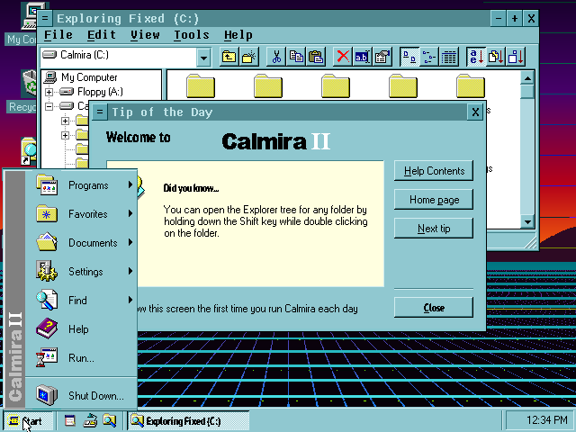
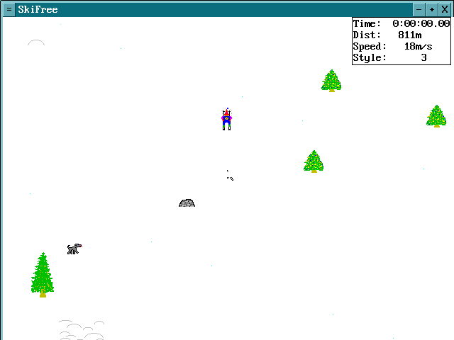
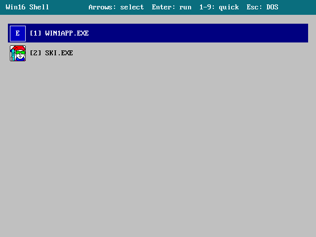
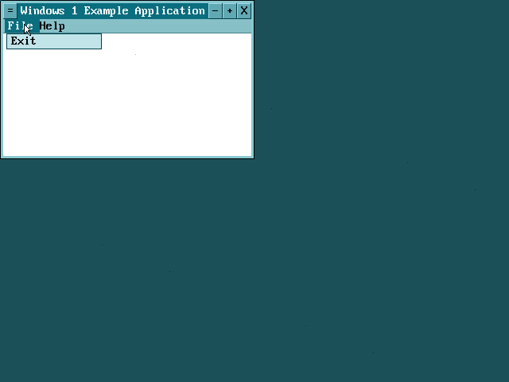

# win16Loader

[English](README.md) | **Polski**

Minimalny loader kompatybilny z Win16 dla architektury i486, działający na bazie FreeDOS.

## Cel projektu

Celem projektu jest uruchamianie oryginalnych aplikacji Win16 na prawdziwym (lub emulowanym) sprzęcie i486 bez pełnej instalacji Windows. Główną aplikacją docelową jest **SkiFree** — klasyczna gra narciarska z 1991 roku napisana oryginalnie dla Win16, dostępna na stronie https://ski.ihoc.net/

## Jak to działa

Loader uruchamia się z obrazu dyskietki FreeDOS. Implementuje:
- parser i loader formatu NE (New Executable),
- przełączanie w 16-bitowy tryb chroniony (protected mode) z własną konfiguracją GDT/IDT,
- minimalne implementacje API Win16: `KERNEL.EXE`, `USER.EXE`, `GDI.EXE`,
- mechanizm thunków INT 3F do wywołań DLL z poprawnym przełączaniem rejestru DS,
- bufor ramki VESA (640×480) z renderowaniem GDI przez selektory typu huge,
- loader zasobów `RT_BITMAP` do renderowania sprite'ów 4bpp,
- timer IRQ0, kolejkę komunikatów oraz menedżer okien.

## Obecny stan

SkiFree działa (sprite'y, pętla gry, pasek stanu). Dostępna jest powłoka graficzna z ikonami NE, menedżer okien z paskiem tytułu / przyciskiem zamknięcia / menu systemowym / przenoszeniem okien oraz poprawny powrót do powłoki po zakończeniu aplikacji.

Przepisane moduły `KERNEL`/`USER`/`GDI` (katalogi `kernel/`, `user/`, `gdi/`) wraz z mniejszymi systemowymi bibliotekami DLL (`dlls/`: SHELL, KEYBOARD.DRV, TOOLHELP, DDEML, VER, MMSYSTEM, COMMDLG) uruchamiają powłokę **Calmira II** (Delphi 1): pulpit, pasek zadań, menu Start i okna dialogowe (`make run-calmira`; najpierw wypakuj Calmira II 3.3 ze strony <http://www.calmira.org/downloads/> do `../win31_apps/english_calmira/calmii33`).
Każda funkcja ma aplikację testową w `example_apps/` (`python3 tools/run_examples.py`).

## Zrzuty ekranu

| Powłoka Calmira II 3.3 (menu Start, Porada dnia, Eksplorator) |
|---|
|  |

| SkiFree (oryginalny plik binarny Win16) | Powłoka graficzna z ikonami NE |
|---|---|
|  |  |

| Przykładowa aplikacja Win16 (pasek menu, przyciski paska tytułu) |
|---|
|  |

## Budowanie

### Używane wersje narzędzi

| Narzędzie | Wersja |
|-----------|--------|
| Open Watcom C/C++ (wcc, wlink) | 2.0 beta (3 lis 2025) |
| NASM | 3.01 |
| GNU Make | 4.4.1 |
| QEMU | 11.0.0 |
| Bochs | 3.0 |

Open Watcom jest zainstalowany w `/opt/watcom`. Plik Makefile automatycznie ustawia wymagane zmienne środowiskowe (`WATCOM`, `INCLUDE`, `PATH`).

### Kroki budowania

```bash
make            # zbuduj wszystko (kompilacja + utworzenie boot.img)
make run-qemu   # uruchom w QEMU, wyjście portu szeregowego na stdout
make run        # uruchom w Bochs z debuggerem GUI

# Środowisko Windows Calmira II:
make run-calmira           # uruchom Calmira II (dysk twardy calmira.img)
make run-calmira-snapshot  # uruchom w trybie tymczasowym/overlay (zmiany na dysku nie są zapisywane)
make reset-calmira         # przywróć calmira.img do czystego/fabrycznego stanu
```

## Struktura projektu

Aktualny kod znajduje się w katalogu głównym repozytorium. Historyczne migawki krok po kroku znajdują się w `steps/`:

| Katalog | Opis |
|---------|------|
| `steps/STEP1` | Środowisko FreeDOS + Hello World COM |
| `steps/STEP2` | Przełącznik trybu chronionego (Protected Mode) |
| `steps/STEP3` | Minimalny jednosegmentowy loader NE |
| `steps/STEP4` | Wielosegmentowy loader NE |
| `steps/STEP5` | Tablica importów + minimalny KERNEL.EXE |
| `steps/STEP7` | Mechanizm thunków DLL przez INT 3F |
| `steps/STEP8` | USER.EXE: klasa okna, kolejka komunikatów |
| `steps/STEP9` | GDI.EXE: bufor ramki VESA + TextOut |
| `steps/STEP10` | Pełnoekranowe TextOut przez selektory typu huge |
| `steps/STEP11` | Prawdziwe numery porządkowe (ordinals) Win16 |
| `steps/STEP12` | GlobalAlloc, InitTask, aktywna pętla gry |
| `steps/STEP13` | Loader `RT_BITMAP`, renderowanie sprite'ów |
| `steps/STEP14` | `patch_gdt` w C (`pm_helpers.c`) |
| `steps/STEP15` | Poprawka `Wsprintf`, `VERTRES=640`, analiza NPC |
| `steps/STEP16`..`STEP20` | Klawiatura/mysz, blity GDI, loader zasobów NE, przykładowa aplikacja, powłoka + WM |
| `SKIFREE` | Plik binarny `SKI.EXE` + skrypty analizy formatu NE |

## Dokumentacja

- [Architektura pamięci i mapa MCB](docs/pamiec.md) – szczegółowy opis dwupoziomowego modelu pamięci (konwencjonalna <640 KB vs XMS >1 MB), mapa MCB, zwalnianie zasobów, alokatory oraz porównanie z Windows 3.1.
- [Obsługa wyjątków CPU i ochrona pamięci](docs/debugging_i_wyjatki.md) – sprzętowe limity segmentów x86 (#GP/#SS), izolacja procesów w trybie wielozadaniowym, ekran paniki VESA (Panic Screen) oraz zrzuty rejestrów i stosu (Crash Dump).
- [Wydajność GDI i podział stron](docs/wydajnosc_gdi.md) – analiza optymalizacji stronicowania pamięci dla emulatora QEMU.

## Licencja

win16Loader jest wolnym oprogramowaniem; możesz go rozpowszechniać i/lub modyfikować na warunkach licencji **GNU Lesser General Public License w wersji 2.1 lub (według własnego wyboru) dowolnej późniejszej wersji** — tej samej licencji co Wine. Zobacz [`LICENSE`](LICENSE).

## Komponenty firm trzecich i podziękowania

| Komponent | Lokalizacja | Licencja | Uwagi |
|-----------|-------------|----------|-------|
| Fonty bitmapowe Wine (`sserife`, `vgasys`, `vgafix`, `coure`, `smalle` `.fon`) | `fonts/` | LGPL-2.1+ | Niezmodyfikowane z Wine 11.20, <https://gitlab.winehq.org/wine/wine/-/tree/master/fonts>; szczegóły w [`fonts/README.md`](fonts/README.md) |
| Pogrubiony MS Sans Serif (`sserifb.fon`) | `fonts/` | SIL OFL 1.1 | Wyrenderowany przez `tools/ttf2fon.py` z PT Sans Narrow Bold autorstwa ParaType, <https://fonts.google.com/specimen/PT+Sans+Narrow>, źródła <https://github.com/google/fonts/tree/main/ofl/ptsansnarrow>; szczegóły w [`fonts/README.md`](fonts/README.md) |
| Pliki `.spec` z Wine (`dlls/*16/*.spec`) | czytane w czasie budowania/analizy z `../wine` (poza repozytorium) | LGPL-2.1+ | `tools/imports.py`, `gen_lnk.py`, `check_args.py`, `gen_apidb.py` pobierają z nich numery porządkowe (ordinals), nazwy i rozmiary argumentów Win16 |
| Odniesienia do zachowania Wine | komentarze w kodzie źródłowym | LGPL-2.1+ | Żaden kod Wine nie został skopiowany; część semantyki została dopasowana do Wine (łatanie prologów eksportów NE `NE_FixupSegmentPrologs`, rejestr 3.1, `WM_SIZE` przy pierwszym `ShowWindow`, rozmiary menu owner-draw, pozycjonowanie okien dialogowych) |
| Przykład Win1App | `win16_example_app/` | Unlicense (domena publiczna) | autor: Transmission Zero, <https://github.com/TransmissionZero/Windows-1-Example-Application>; lokalne zmiany w [`win16_example_app/UPSTREAM.md`](win16_example_app/UPSTREAM.md) |
| Wygaszacz ekranu Win31SS (`WIN31SS.SCR`) | `example_apps/win31-screensaver/` | MIT | autor: Tim Shaw, <https://github.com/tdshaw2000/win31-screensaver>; minimalny szkielet wygaszacza ekranu Win16 z odbijającymi się kształtami, zanikającymi śladami i oknem konfiguracji |
| Dyskietka FreeDOS | `FD14-FloppyEdition/` (poza repozytorium) | GPL i inne | do pobrania z <https://www.freedos.org> |
| SkiFree | poza repozytorium (`SKIFREE/SKI.EXE`) | freeware | aplikacja testowa, <https://ski.ihoc.net/> |
| Calmira II 3.3 (angielska) | poza repozytorium (`../win31_apps/english_calmira/calmii33`, źródła `../win31_apps/english_calmira/cal33src`) | GPL-2.0-or-later | aplikacja testowa, <http://www.calmira.org/downloads/> |

Wine: <https://www.winehq.org>, źródła <https://gitlab.winehq.org/wine/wine>.
